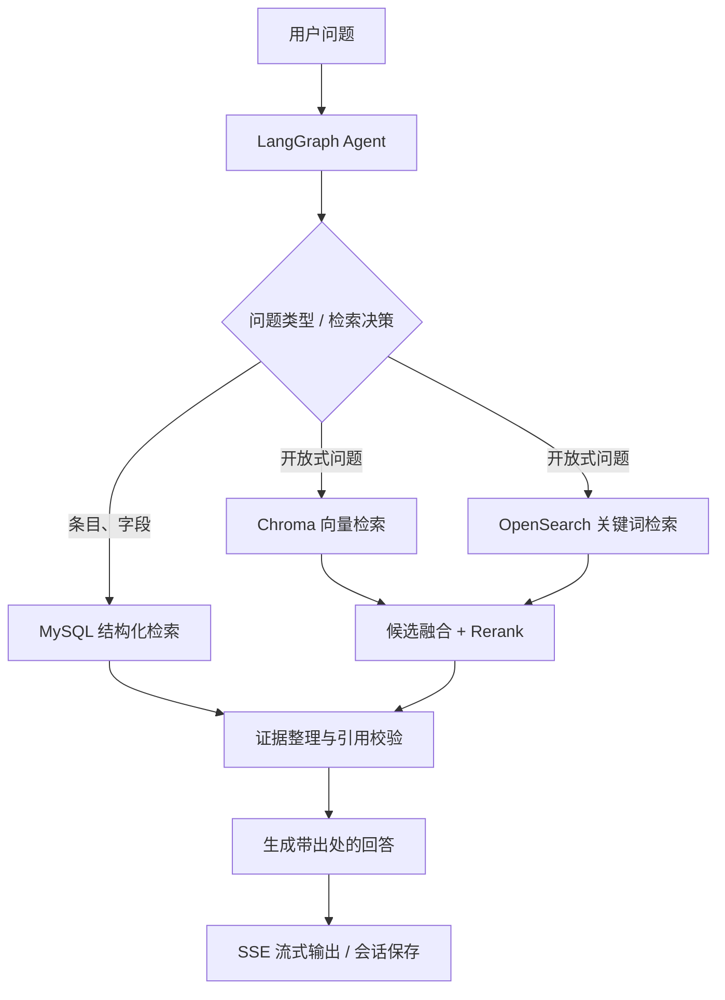

# 👋 Hi, I’m Cloud2020-L

### AI 应用工程师 · Full-Stack Developer

专注于 **AI Agent、RAG 检索增强生成与全栈工程化落地**，
让 AI 应用不仅能回答问题，也能检索证据、执行工具并稳定交付。

---

## 👨‍💻 About Me

- 🎯 方向：**AI 应用开发 / Agent 工作流 / RAG 知识库 / 全栈交付**。
- 🧠 具备 **LangChain、LangGraph** 开发实践，关注工具调用、结构化决策、短期上下文与流式响应。
- 🔎 熟悉 **文档结构化、Embedding、混合检索、候选融合、Rerank、来源引用** 等 RAG 核心环节。
- 🛠️ 具有 **React + TypeScript、NestJS、FastAPI** 等前后端应用开发与联调经验。
- 🚀 使用 **Docker Compose、Nginx、Linux** 完成服务编排、部署与基础故障排查。

## 🧰 Tech Stack

| 方向 | 技术与实践 |
| --- | --- |
| **AI / Agent** | LangChain · LangGraph · 工具调用 · Schema 校验 · 多轮对话 · SSE 流式输出 |
| **RAG / Search** | Embedding · Chroma · Qdrant · OpenSearch · Hybrid Retrieval · Rerank · 引用校验 |
| **Backend** | TypeScript · Node.js · NestJS · TypeORM · Python · FastAPI |
| **Frontend** | React · TypeScript · JavaScript · Vite |
| **Data** | MySQL · PostgreSQL |
| **DevOps** | Docker Compose · Nginx · Linux · Git |
| **Mobile（过往实践）** | Swift · Flutter · Provider · AI 图像处理 API |

## 🌟 Featured Project

### 📚 中医典籍知识问答 Agent

**个人项目｜TypeScript · NestJS · LangGraph · MySQL · Chroma · OpenSearch · SSE**

面向中医典籍的查阅与知识问答场景，在 CMS 基础上构建**结构化检索、语义检索、多轮对话和原文证据引用**能力，由 Agent 根据问题选择检索、补查或澄清，再生成可追溯出处的回答。

**核心设计：**

- **Agent 工作流**：LangGraph 外层业务图与内层取证子图分工，统一同步与流式入口的业务流程。
- **分层检索**：条目/字段类问题优先结构化查询，开放式问题结合向量与关键词召回，经候选融合、Rerank 后整理证据。
- **证据可信性**：保留来源位置、页码与版本信息，处理去重、上下文预算和引用编号校验；区分零命中与检索异常。
- **工具执行约束**：为模型动作增加 Schema 校验、检索与决策次数限制、超时控制、重复查询缓存和取消信号传递。
- **会话与流式响应**：按完整轮次维护短期记忆，区分对话内容与执行审计，通过 SSE 输出正文与阶段进度。
- **测试与排查**：覆盖工作流分支、检索来源、引用约束、异常降级和流式取消，配合分阶段日志排查链路问题。

<b>查看简化技术流程</b>

> 示意图仅展示简化后的核心检索与生成链路。

## 💼 Engineering Experience

### 🌐 GEO / AI 可见性增长平台 · 全栈开发

- 参与基于 **React、FastAPI、PostgreSQL、Qdrant** 的平台搭建与维护，覆盖诊断、内容生成、分发、复测及计费等业务环节。
- 负责多门户前端构建部署、接口代理与静态资源发布，并参与多租户权限、客户数据隔离及计费模块优化。
- 使用 **Docker Compose** 编排 PostgreSQL、Qdrant、FastAPI 与 Nginx，推动服务拆分部署。

### 📱 iOS 工具类产品 · 移动端开发

- 采用 **Swift + Flutter** 混合开发，参与商品加载、购买流程、订单校验和跨平台功能开发。
- 集成 **AI 图像处理 API**，实现证件照背景替换、人像分割与颜色调整等功能。
- 通过异步加载、缓存及状态管理优化性能，并配合测试完成 App Store 上架工作。

## 🧩 What I Care About

> **可验证的检索证据 · 可控的 Agent 决策 · 可观测的执行链路 · 可交付的完整系统**

持续关注 AI 应用从原型走向工程实践时的关键问题：检索效果、引用可信度、异常处理、流式交互、会话一致性与部署维护。

---

**🔗 Connect**

[GitHub Profile](https://github.com/Cloud2020-L) · [Repositories](https://github.com/Cloud2020-L?tab=repositories)

技术名片基于个人项目及工程经历整理；不展示私人手机号等敏感信息。

